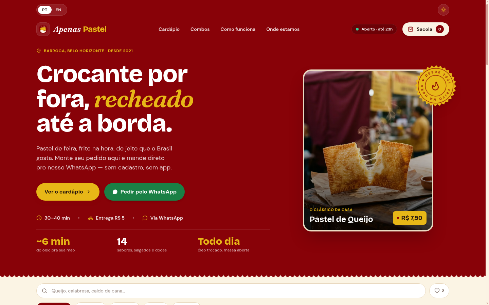
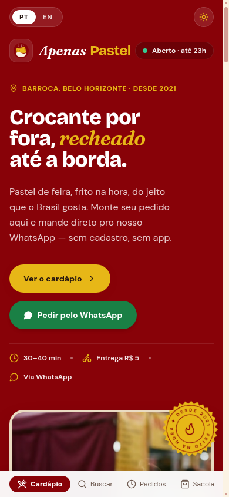

<p align="center">
  <picture><source media="(prefers-color-scheme: dark)" srcset="https://shieldcn.dev/header/graph.svg?title=Apenas+Pastel&subtitle=Pastelaria+artesanal+%C2%B7+Crocante+por+fora%2C+recheado+at%C3%A9+a+borda&align=left&font=geist-mono&mode=dark&logo=https%3A%2F%2Fraw.githubusercontent.com%2FBGLuis%2Fapenas-pastel%2Fmain%2Fpublic%2Fimages%2Flogo-simbolo.svg" /></picture>
</p>

<p align="center"><b>Português (BR)</b> · <a href="README.en.md">English</a></p>

<p align="center">
  <picture><source media="(prefers-color-scheme: dark)" srcset="https://shieldcn.dev/github/stars/BGLuis/apenas-pastel.svg?variant=secondary&size=sm&mode=dark" /></picture>
  <picture><source media="(prefers-color-scheme: dark)" srcset="https://shieldcn.dev/github/forks/BGLuis/apenas-pastel.svg?variant=secondary&size=sm&mode=dark" /></picture>
  <picture><source media="(prefers-color-scheme: dark)" srcset="https://shieldcn.dev/github/watchers/BGLuis/apenas-pastel.svg?variant=secondary&size=sm&mode=dark" /></picture>
  <picture><source media="(prefers-color-scheme: dark)" srcset="https://shieldcn.dev/github/contributors/BGLuis/apenas-pastel.svg?theme=emerald&size=sm&mode=dark" /></picture>
  <picture><source media="(prefers-color-scheme: dark)" srcset="https://shieldcn.dev/github/license/BGLuis/apenas-pastel.svg?variant=ghost&size=sm&mode=dark" /></picture>
</p>

<p align="center">
  
  
  
  
</p>

# 📖 Sobre

O **Apenas Pastel** é uma aplicação web moderna e interativa desenvolvida com Next.js 15, React 19, TypeScript e Tailwind CSS para uma pastelaria artesanal de Belo Horizonte (bairro Barroca). O projeto traduz com precisão o design do Figma (mobile e desktop) em uma experiência de usuário fluida para pedidos de pastel de feira com personalização de recheios e adicionais, cálculo de frete grátis, alternância de tema claro/escuro e finalização de pedido integrada ao WhatsApp.

# 📋 Motivo

Criado como a ideia de um renascimento de um projeto antigo do tempo do ensino médio.

# 🚀 Demonstração & Links

- 🌐 **Deploy na Vercel**: [https://apenas-pastel-remaster-hd.vercel.app](https://apenas-pastel-remaster-hd.vercel.app)
- 📦 **Repositório GitHub**: [https://github.com/BGLuis/apenas-pastel](https://github.com/BGLuis/apenas-pastel)
- 🎨 **Design no Figma**:
  - [Mobile (Node 2:3)](https://www.figma.com/design/LJd6nBzQlj6H8KiSV12TtK/Apenas-pastel?node-id=2-3)
  - [Desktop (Node 2:4)](https://www.figma.com/design/LJd6nBzQlj6H8KiSV12TtK/Apenas-pastel?node-id=2-4)

# 📸 Demonstração Visual

<p align="center">
  
</p>

<p align="center">
  
</p>

# ⚡ Benchmarks & Performance

Auditoria oficial realizada via **Google Lighthouse (v13.5.0)** diretamente sobre o deploy de produção:

<p align="center">
  
  
  
  
</p>

### Métricas Core Web Vitals (Auditoria Científica de Mercado)

| Métrica | Valor Medido | Meta Google CWV | Classificação |
| :--- | :--- | :--- | :--- |
| **First Contentful Paint (FCP)** | 0.9 s | < 1.8 s | 🟢 Bom (Rápido) |
| **Speed Index** | 1.3 s | < 3.4 s | 🟢 Bom (Rápido) |
| **Total Blocking Time (TBT)** | 40 ms | < 200 ms | 🟢 Bom (Excelente) |
| **Cumulative Layout Shift (CLS)** | 0 | < 0.1 | 🟢 Perfeito (Zero deslocamento) |
| **Largest Contentful Paint (LCP)** | 3.1 s | < 2.5 s | 🟡 Otimizável |

# ✨ Recursos & Funcionalidades

- **Design Responsivo & Mobile-First**: Adaptação perfeita desde viewports mobile de 390px até telas desktop ultrawide.
- **Borda de Pastel Vetorial**: Divisor de seção customizado reproduzindo o fechamento com garfo tradicional de pastel de feira.
- **Saindo da Fritadeira**: Carrossel horizontal de fornadas em tempo real com indicador visual pulsante.
- **Detalhes de Produto com Drawer Tátil (`vaul`)**:
  - Seleção de adicionais (borda recheada, queijo extra, vinagrete).
  - Observações customizadas do pedido.
  - Informações rápidas: tempo de preparo, picância e porções.
  - Controle dinâmico de quantidade.
- **Sacola Interativa & Cálculo de Frete Grátis**:
  - Barra de progresso dinâmica até o valor de entrega grátis.
  - Alternador segmentado entre entrega a domicílio e retirada no balcão.
  - Carrossel de upsell com sugestões de bebidas e acompanhamentos.
  - Notificações de ação com suporte a desfazer via `sonner`.
- **Checkout Integrado com WhatsApp**:
  - Fluxo estruturado: identificação, endereço de entrega e forma de pagamento.
  - Geração e envio da mensagem pré-formatada diretamente para o WhatsApp do estabelecimento.
- **Celebração de Pedido Realizado**: Animação de confetes interativa via `canvas-confetti` com acompanhamento de etapas.
- **Temas Claro e Escuro (Dark/Light Mode)**: Alternância suave sem flash de renderização via `next-themes`.
- **Suporte a Internacionalização (i18n)**: Alternância dinâmica e reativa entre Português e Inglês.

# 💻 Como iniciar

### Requisitos

- [Node.js](https://nodejs.org)
- [npm](https://www.npmjs.com)

### Instalação

1. Clone o repositório:

   ```sh
   git clone https://github.com/BGLuis/apenas-pastel.git
   ```

2. Entre no diretório do projeto:

   ```sh
   cd apenas-pastel
   ```

3. Instale as dependências e inicie o servidor de desenvolvimento:

   ```sh
   npm install
   npm run dev
   ```

Abra [http://localhost:3000](http://localhost:3000) no navegador para visualizar a aplicação.

# 🤝 Contribuidores

<a href="https://github.com/BGLuis/apenas-pastel/graphs/contributors">
  <picture><source media="(prefers-color-scheme: dark)" srcset="https://shieldcn.dev/contributors/BGLuis/apenas-pastel.svg?title=false&preset=transparent&border=false&mode=dark" /></picture>
</a>

# 📄 Licença

Distribuído sob a licença [MIT](LICENSE).
